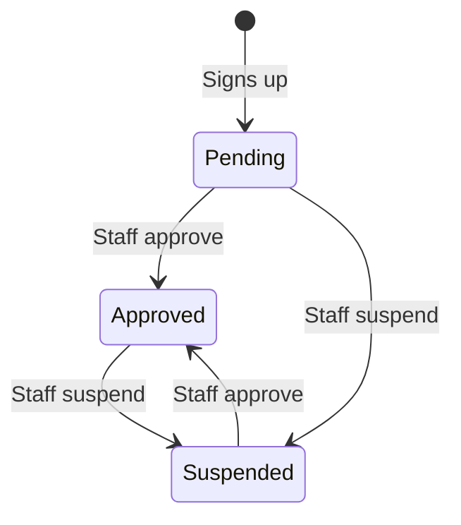
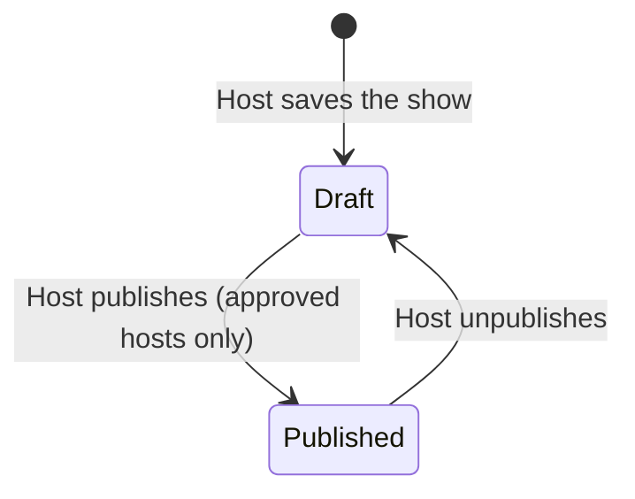
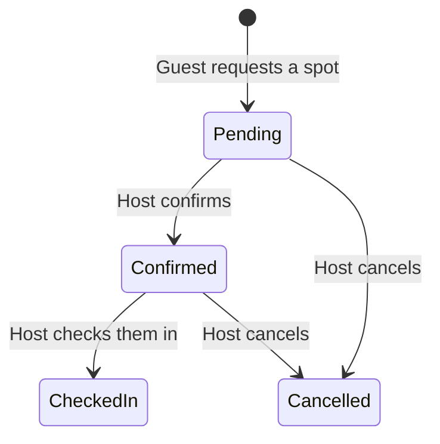

# GigHaus concepts

This page explains how GigHaus thinks about people, shows and money. For the pages themselves, see [Features.md](Features.md).

## People

| Term | Meaning | In the code |
|---|---|---|
| **Host** | A person or household that opens a private space for shows. Hosts are the venues, and the audience for GigHaus's sales effort. | `Host`, role `Host` |
| **Artist** | A performer. Hosts add artists to shows. Artists don't have accounts yet. | `Artist` |
| **Guest** | Someone who reserves a spot. Guests don't have accounts, and only need an email address. | `Reservation.AttendeeName`, `AttendeeEmail` |
| **Staff** | The GigHaus team. Staff review hosts and work leads. | role `Admin` |
| **Lead** | A prospective host who filled in the contact form but may not have signed up. | `Lead` |

The site says "guest" and "show". The code says "attendee" and "event". They mean the same things.

## How a host joins

A new host can start in two ways:

- **Sign up directly** at `/signup`. They're signed in straight away, and their status is Pending.
- **Get in touch first** at `/contact`. That creates a lead for staff to follow up.

| Status | What the host can do | What guests see |
|---|---|---|
| **Pending** | Edit their venue and draft shows. They can't publish. | Nothing |
| **Approved** | Everything, including publishing shows. | Published shows |
| **Suspended** | Sign in and see their data. They can't publish. | Nothing: published shows return "not found" |

Approving a host emails them a link to the portal.

## The sales pipeline

Leads move through four stages, shown on `/admin/leads`:

| Stage | Meaning |
|---|---|
| **New** | Just arrived. Counted on the admin dashboard. |
| **Contacted** | Staff have reached out. |
| **Signed up** | The person created a host account. This happens automatically when the email matches. |
| **Not interested** | Closed. |

Staff can keep private notes on each lead.

## Shows

A show (`Event`) belongs to one host and one artist. Hosts can pick an existing artist or add a new one by name and email. If that email already belongs to an artist, GigHaus reuses that artist.

These rules are enforced in `HostPortalService`:

- A new show's date can't be in the past.
- The guest limit must be between 1 and the venue's capacity.
- The guest limit can't drop below the number of spots already reserved.
- The end time must be after the start time.

Each published show has a shareable page at `/shows/{id}`. There's no public list of shows, so a show is only found through its link.

## Reservations

- A guest can request up to 20 spots in one reservation.
- Pending, Confirmed and Checked in reservations all count toward the guest limit. Cancelled ones free their spots.
- When the limit is reached, the show page says it's full and stops taking requests.
- Confirming a guest emails them the street address.

## Money

GigHaus doesn't take a fee, and doesn't handle any money today. Guests contribute at the door.

Hosts choose one of two contribution policies for each show:

| Policy | What guests see | `PricingMode` |
|---|---|---|
| **Suggested donation** | "Suggested donation: $25. Pay what you can, at the door." | `SuggestedOnly` |
| **Minimum contribution** | "Minimum contribution to attend: $15", stated plainly as required | `MinimumRequired` |

The wording matters. A required amount must never look optional, and every show page carries this disclosure near the reservation form:

> Payments support the artist and event hosting. These payments are not charitable donations and are not tax-deductible unless explicitly stated otherwise.

The domain model has more than the portal uses today, including online payments, `ReserveNowPayLater` and `DoorOnly` modes, payment records and settlement summaries. Those parts are designed around Stripe Connect but aren't live. See the [legal notes](GigHaus_Legal_and_Pricing_Notes.md) for why collecting money for artists needs legal review before it's turned on.

## Privacy

Hosts are private homes, so their details are treated as sensitive.

| Information | Who can see it |
|---|---|
| Show title, artist name, date, city and state | Anyone with the link |
| Street address and ZIP code | The host, staff, and guests the host has confirmed (by email) |
| Host email and phone | The host and staff |
| Guest names, emails and notes | The host of that show, and staff through the database |
| Artist email and phone | Staff. Hosts see artist names only. |
| Leads | Staff |

The public API follows the same rules. `GET /api/events` returns a limited view with the city and no contact details, and only for published shows from approved hosts.

## Accounts and sign-in

- Accounts are ASP.NET Core Identity users, stored by `DapperUserStore` in the `users` table. The email address is the user name.
- Each user has exactly one role, `Host` or `Admin`. Host users are linked to their host profile by `HostId`.
- Passwords need at least 10 characters. Five wrong attempts lock an account for 15 minutes.
- Sign-in lasts 14 days with "Keep me signed in", and otherwise until the browser closes.
- Interactive sessions are rechecked every 5 minutes, so a removed account or changed password ends them.
- Removing a staff member is a soft delete: the row stays, marked as deleted. Staff can't remove themselves, so one account always remains.

**Ownership.** Portal pages take the host from the signed-in user and never from the URL. `HostPortalService` then checks that every show and guest belongs to that host, so changing an ID in a link gets a host nothing.

The first staff account comes from the `Admin:Email` and `Admin:Password` settings. It's only created when no staff exist yet.

## Protecting public forms

- Every form uses anti-forgery tokens.
- The contact and reservation forms have a hidden field that only bots fill in. Those submissions look successful but aren't saved.
- Each IP address can make 30 form posts a minute.
